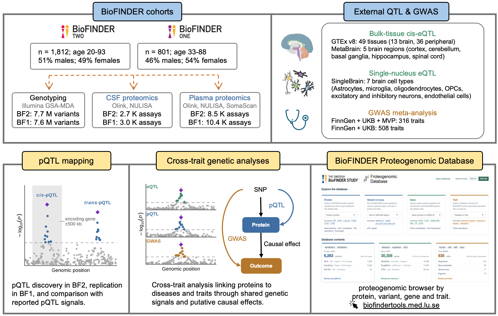

# BioFINDER Proteogenomic Database

Analysis code for the BioFINDER proteogenomic study of cerebrospinal fluid (CSF)
and plasma proteins. pQTLs were discovered in BioFINDER-2, replicated in
BioFINDER-1, fine-mapped, and linked to gene expression and disease through
colocalization and Mendelian randomization.

Results can be browsed at https://biofindertools.med.lu.se/proteogenomic.

## Cohorts and data

|  | BioFINDER-2 (discovery) | BioFINDER-1 (replication) |
|---|---|---|
| Participants | 1,812; age 20–93; 51% male | 801; age 33–88; 46% male |
| Genotyping | Illumina GSA-MDA, TOPMed imputation; 7.7 M variants | Illumina GSA-MDA, TOPMed imputation; 7.6 M variants |
| CSF proteomics | Olink, NULISA; 2.7 K assays | Olink, NULISA; 3.0 K assays |
| Plasma proteomics | Olink, NULISA, SomaScan; 8.5 K assays | Olink, NULISA, SomaScan; 10.4 K assays |

External resources integrated with the pQTLs:

| Resource | Type | Scope |
|---|---|---|
| GTEx v8 | Bulk-tissue *cis*-eQTL | 49 tissues |
| MetaBrain | Bulk-tissue *cis*-eQTL | 5 brain regions |
| SingleBrain | Single-nucleus *cis*-eQTL | 7 brain cell types |
| FinnGen + UK Biobank + MVP | Disease GWAS meta-analysis | 316 traits |
| FinnGen + UK Biobank | Disease GWAS meta-analysis | 508 traits |

**Data availability.** Full pQTL summary statistics are deposited in the
SciLifeLab Data Repository (**[DOI]**). Protein, variant, gene and disease
results can be browsed at https://biofindertools.med.lu.se/proteogenomic.
Pseudonymized BioFINDER data are available to qualified academic researchers on
request, for the purpose of replicating the analyses reported in this study.
Requests should be directed to bf_executive@med.lu.se. No individual-level data
are included in this repository.

## Methods and code

| Analysis | Main settings |
|---|---|
| pQTL mapping | Additive imputed-dosage model in PLINK 2; rank-based inverse-normalized proteins; age, sex, ten genetic principal components and platform-specific mean protein as covariates; MAF ≥ 0.01; dosage missingness ≤ 5% |
| Clumping | P < 5 × 10⁻⁸; 1,000-kb window; r² < 0.01; *cis* defined as ±500 kb from the encoding gene |
| Fine-mapping | `susie_rss`; ±500-kb windows; `L = 10`; `max_iter = 1,000`; 1000 Genomes phase 3 European LD; MHC excluded |
| Replication | Concordant direction and P < 0.05 in BioFINDER-1 |
| Colocalization | `coloc.susie`; at least 50 shared variants; PP4 > 0.8 |
| Mendelian randomization | *cis*-pQTL instruments outside the MHC; Wald ratio for one instrument; inverse-variance weighting and sensitivity analyses for multiple instruments; Benjamini–Hochberg FDR < 0.05 |

Methods are described in full in the manuscript. The scripts below are listed in
the order they were run. They reproduce the study-specific analyses but are not
a general-purpose pipeline: input and output paths point to local data
directories and need to be configured. Scripts are run from the repository root.

### 1. Genotype QC — [`code/01_genotype_qc/`](code/01_genotype_qc/)

| Script | Description |
|---|---|
| `00_ref_1kg_eur_hg38.sh` | Prepare the 1000 Genomes phase 3 European reference (hg38) |
| `00_ref_highld_hg38.sh` | Lift high-LD exclusion regions to hg38 |
| `01_preimpute_qc_bf1.sh`, `01_preimpute_qc_bf2.sh` | Pre-imputation QC of the genotyping arrays and VCF preparation for the TOPMed Imputation Server |
| `02_extract_sample_ids.py` | Extract participant identifiers from the phenotype export |
| `03_make_genetic_key.R` | Map participant IDs to genotype sample IDs |
| `04_vcf_import.sh` | Import TOPMed-imputed VCFs |
| `05_array_sex_check.sh` | Compare genetic and reported sex |
| `06_qc_harmonize_1kg.sh` | Post-imputation QC, liftover to hg19 and harmonization with 1000 Genomes |
| `07_ancestry_pca.sh` | Genetic ancestry and principal components by projection onto 1000 Genomes |
| `lib/` | Shared QC functions |

### 2. Protein QC — [`code/02_protein_qc/`](code/02_protein_qc/)

| Script | Description |
|---|---|
| `01_process_protein.py` | Protein QC per platform and panel; GWAS phenotype files |
| `02_process_covar.py` | GWAS covariates: age, sex, genetic principal components and mean protein level |
| `03_annot_ensg.R` | Map assays to Ensembl genes and define *cis* windows |
| `04_annot_uniprot.py` | Map assays to UniProt |
| `05_uniprot_features.py` | Protein features from UniProt (subcellular location, secretion, etc.) |
| `06_prepare_bf1_pqtl.py` | Prepare BioFINDER-1 protein panels for replication GWAS |
| `07_drug_targets.py` | Drug-target annotation from Open Targets |
| `utils/` | Shared protein-processing functions |

### 3. pQTL mapping — [`code/03_pqtl_mapping/`](code/03_pqtl_mapping/)

| Script | Description |
|---|---|
| `01_gwas_protein.sh` | Protein GWAS with PLINK 2 |
| `02_clean_sumstats.R` | Harmonize GWAS summary statistics |
| `03_bf1_sumstats_qc.R` | Completeness check of the BioFINDER-1 summary statistics |
| `04_clump_input.sh` | Select genome-wide significant variants for clumping |
| `05_clump.sh` | LD clumping |
| `06_collect_pqtl.R` | Collect lead pQTLs and classify them as *cis* or *trans* |
| `07_annotation.R` | Variant annotation with VEP |

### 4. Fine-mapping — [`code/04_finemapping/`](code/04_finemapping/)

| Script | Description |
|---|---|
| `prep_eqtl_cis_loci.R` | Select eQTL loci to fine-map for colocalization |
| `prep_finngen_cis_loci.R` | Select disease GWAS loci near protein *cis* windows to fine-map |
| `01_finemapping.R` | SuSiE fine-mapping of each locus |
| `02_collect_lead_snps.R` | Collect credible sets and their lead variants |
| `03_dedup_credible_sets.R` | Merge credible sets that capture the same signal in overlapping windows |
| `04_build_signal_tables.R` | Locus and credible-set tables |

### 5. Replication — [`code/05_replication/`](code/05_replication/)

| Script | Description |
|---|---|
| `01_prepare_bf1_replication.R` | Credible-set lead variants to test in BioFINDER-1 |
| `01a_extract_cs_members.R` | Credible-set members used as proxies when a lead is missing |
| `02_extract_replication_chunk.R` | Extract the variants from the BioFINDER-1 summary statistics |
| `03_collect_bf1_replication.R` | Collect the replication results |
| `04_credible_set_status.R` | Replication status of each credible set |

### 6. External data — [`code/06_external_data/`](code/06_external_data/)

| Script | Description |
|---|---|
| `gtex_download.sh`, `gtex_clean.R` | Download and harmonize GTEx v8 *cis*-eQTLs |
| `metabrain_download.sh`, `metabrain_clean.R` | Download and harmonize MetaBrain *cis*-eQTLs |
| `singlebrain_download.sh`, `singlebrain_clean.R` | Download and harmonize SingleBrain *cis*-eQTLs |
| `singlebrain_collect_info.R`, `singlebrain_sample_size.R` | SingleBrain gene lists and sample sizes |
| `finngen_clean.R` | Harmonize the FinnGen meta-analysis disease GWAS |
| `finngen_reclass.R` | Group FinnGen endpoints into disease categories |
| `other_clean.R` | Harmonize other disease GWAS |
| `collect_trait_info.R` | Metadata (sample size, category) for every trait |

### 7. Colocalization — [`code/07_colocalization/`](code/07_colocalization/)

| Script | Description |
|---|---|
| `protein_x_eqtl_01_pair.R` | Protein *cis*-pQTL × eQTL of the encoding gene (GTEx, MetaBrain, SingleBrain): proteins to test |
| `protein_x_eqtl_02_coloc.R` | Run `coloc.susie` |
| `protein_x_eqtl_03_collect.R` | Collect results |
| `protein_x_disease_01_pair.R` | Protein *cis*-pQTL × disease GWAS: pairs to test |
| `protein_x_disease_02_coloc.R` | Run `coloc.susie` |
| `protein_x_disease_03_collect.R` | Collect results |
| `mb_x_disease_01_pair.R` | MetaBrain eQTL × disease GWAS: pairs to test |
| `mb_x_disease_02_coloc.R` | Run `coloc.susie` |
| `mb_x_disease_03_collect.R` | Collect results |
| `qc_shared_variants.R` | Coverage of the shared variants at each colocalized locus |
| `coloc_protein_x_qtl.R`, `coloc_x_disease.R`, `collect_chunked.R`, `functions_coloc.R`, `functions_db.R` | Shared functions |

### 8. Mendelian randomization — [`code/08_mendelian_randomization/`](code/08_mendelian_randomization/)

| Script | Description |
|---|---|
| `01_pair_protein2disease.R` | Protein–disease pairs to test |
| `02_extract_iv.R` | *cis*-pQTL instruments |
| `03_run_protein2disease.R` | Two-sample MR |
| `04_collect_protein2disease.R` | Collect MR results |
| `functions_mr.R`, `functions_db.R` | Shared functions |

### 9. Statistical analysis — [`code/09_statistical_analysis/`](code/09_statistical_analysis/)

Downstream analyses, figures and tables. Scripts in `local/` use
individual-level data; all others use summary-level results.

| Script | Description |
|---|---|
| `00_dedup_assays.R` | Analysed assays: one assay per protein and fluid |
| `00b_gwas_qc.R` | GWAS sample size and genomic inflation per assay |
| `local/00c_sample_counts.R` | Participants per cohort and fluid |
| `01a_pqtl_data.R` | pQTL summary and replication data |
| `01b_hotspot_data.R` | *trans*-pQTL hotspots |
| `01b_hotspot_enrichment.R` | Pathway enrichment of hotspot target proteins |
| `01c_plot.R` | pQTL map, hotspot and replication figures |
| `02_protein_features.R` | Protein properties associated with carrying a pQTL |
| `03_fluid_specificity.R` | Shared and fluid-specific pQTLs |
| `03b_variant_annotation.R` | Functional annotation of shared and fluid-specific signals |
| `03c_plot_annotation.R` | Variant annotation and regulatory-context figure |
| `04_protein_tissue.R` | Tissue context: colocalization with GTEx and MetaBrain eQTLs |
| `04b_protein_celltype.R` | Brain cell-type context: colocalization with SingleBrain eQTLs |
| `04c_plot_tissue_context.R` | Tissue-context supplementary figure |
| `05a_disease_data.R` | Protein–disease associations supported by MR and colocalization |
| `05b_case_data.R` | Protein–disease pairs without a prior report |
| `05b_drug_support.py` | Drug-target support of protein–disease pairs |
| `05d_link_matrix.R` | Protein–disease links by fluid |
| `05e_joint_iv_match.R` | Agreement between MR instruments and colocalized variants |
| `05f_locus_data.R`, `05g_locus_plot.R` | Locus plots of protein–disease examples |
| `05h_ad_gwas.R` | Colocalization with Alzheimer's disease GWAS |
| `05c_plot.R` | Protein–disease figures |
| `06_supplementary_tables.R` | Supplementary tables |
| `07a_novelty_refs.R` | Reference tables of previously reported pQTLs |
| `07b_novelty_scan.R` | Comparison with previously reported pQTLs |
| `07c_western_download.sh`, `07c_western_replication.R` | External replication in Western et al. 2026 |
| `09a_novel_candidates.R` | CSF pQTLs without a prior report |
| `09d_novel_evidence.R` | Supporting evidence for these pQTLs |
| `09e_novel_vs_known.R` | Comparison of novel and previously reported pQTLs |
| `09e_lrrc25_locus.R`, `09e_lrrc25_alleles.R` | *LRRC25* locus example |
| `09f_plot_novelty.R` | Novelty figure |
| `local/10a_fluid_heterogeneity.R` | CSF versus plasma genetic effects in the same participants |
| `local/10b_pqtl_context.R` | pQTL effects across the Alzheimer's disease continuum |
| `10d_plot_regulatory_context.R`, `10e_locus_data.R` | Regulatory-context and locus panels |
| `10_plot.R` | Paired-fluid figure |
| `local/11a_snp_brain.R` | Variant associations with regional brain structure |
| `local/11c_snp_clinical.R` | Variant associations with cognitive decline and clinical progression |
| `local/12_fluid_clinical.R` | Clinical associations of CSF and plasma levels |
| `local/12e_clinical_sample.R` | Sample description for the clinical models |
| `12b_fluid_clinical_summary.R` | Summary of the fluid–clinical analysis |
| `12f_pathology_proteins.R` | Proteins by amyloid and tau stage |
| `12c_plot.R`, `12d_plot_examples.R`, `12e_plot_clinical_overview.R` | Clinical figures |
| `13_somascan_olink_plasma.R` | Plasma Olink–SomaScan pQTL comparison |
| `overview_plot.R` | Study-overview schematic |
| `lib/` | Shared functions and figure style |

### Shared functions — [`code/lib/`](code/lib/)

Constants and helpers used across steps: analysis thresholds and data paths
(`common.R`, `common.sh`), MHC region (`mhc.R`, `mhc_hg19.range`), *cis*
windows (`cis_windows.R`), GWAS harmonization (`gwas_functions.R`) and locus
plots (`locus_plot.R`, `locus_plot_spec.json`).

## Software

Core analyses used R 4.4.3, PLINK 2, coloc 5.2.3, susieR 0.14.2 and
TwoSampleMR 0.7.4. The R environment is recorded in `environment.yml`.

## License

MIT; see [LICENSE](LICENSE).
